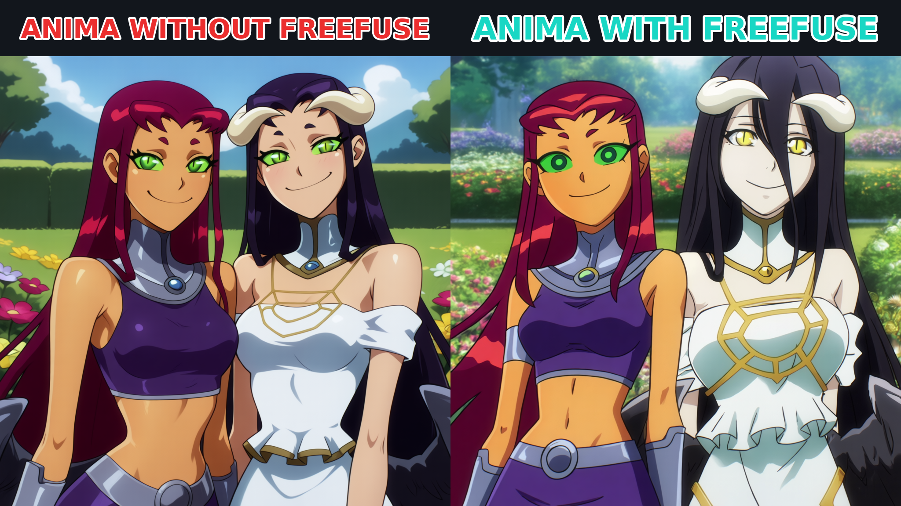
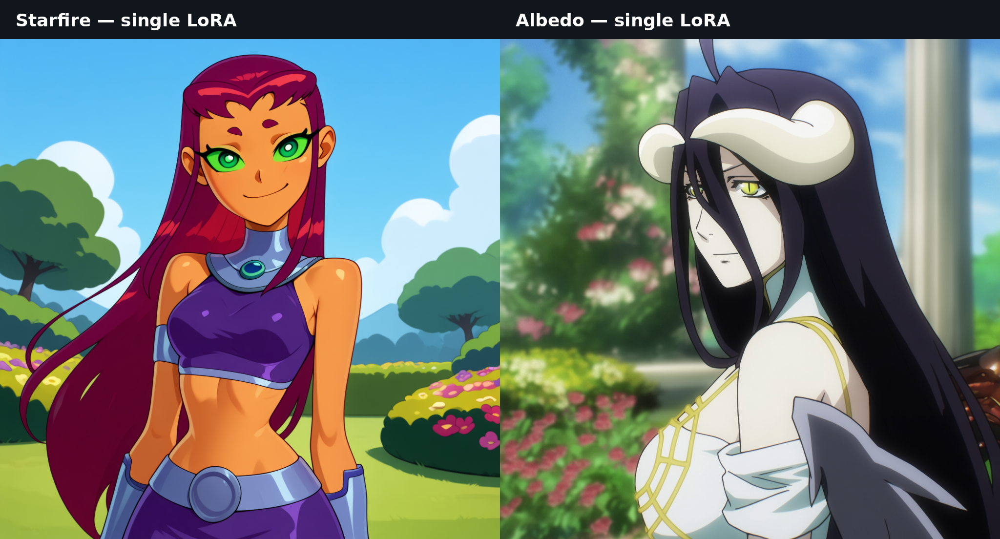

# Anima support (ComfyUI)

FreeFuse supports native [Anima Base v1.0](https://huggingface.co/circlestone-labs/Anima)
through the existing ComfyUI nodes. Phase 1 infers character regions with LoRAs
disabled. Phase 2 restarts from the same noise and applies spatial LoRA routing
and image-to-text attention bias. The baseline activates both LoRAs globally.

## Setup

Update ComfyUI to a version with native Anima support. The integration was tested
with ComfyUI commit `1a82e6d01f395b43275c77acd289af1eb7090bb9`. Install
FreeFuse as a custom node, then open
[anima_freefuse_complete.json](../freefuse_comfyui/workflows/anima_freefuse_complete.json)
from Templates → freefuse. An [API-format workflow](../freefuse_comfyui/workflows/anima_freefuse_api.json) is also included.

Download the following files from the
[official model repository](https://huggingface.co/circlestone-labs/Anima/tree/main/split_files):

| ComfyUI folder | File |
| --- | --- |
| models/diffusion_models | anima-base-v1.0.safetensors |
| models/text_encoders | qwen_3_06b_base.safetensors |
| models/vae | qwen_image_vae.safetensors |

Use UNETLoader for the diffusion model. In CLIPLoader select the Qwen-3 0.6B file
and type `stable_diffusion`: ComfyUI detects these encoder weights as Anima.
There is no `anima` entry in the tested CLIPLoader type dropdown.
Use EmptyCosmosLatentVideo with width/height 1024, length 1, batch size 1.
Anima uses 16-channel latents shaped `[1,16,1,H/8,W/8]`; EmptyLatentImage and
EmptyFlux2LatentImage produce incompatible shapes.

Download **Anima-specific** LoRAs separately into models/loras:

| Adapter | Creator / model | Version | File / trigger |
| --- | --- | --- | --- |
| starfire | [Starfire by CitronLegacy](https://civitai.com/models/1564966) | [3332572](https://civitai.com/models/1564966?modelVersionId=3332572) | StarfireTT_ANIMAv1_v3.safetensors / strfr |
| albedo | [Albedo by CitronLegacy](https://civitai.com/models/2809374) | [3168039](https://civitai.com/models/2809374?modelVersionId=3168039) | AlbedoOverlord_ANIMAv1_v1.safetensors / lbd0c1tr0n |

Both example LoRAs use strength 1.0; all 280 targets per LoRA match the native
model. FLUX, SDXL, Z-Image and MOSS LoRAs are incompatible. Civitai can require
authentication. Keep credentials outside the repository; weights are not bundled.

## Example and settings



Each generated image is 1024 × 1024. Both runs use seed 42, 30 steps, CFG 4.5,
Euler/simple, the same prompt and the same two LoRAs. FreeFuse collects at node
step 5, block 12, with top-k 0.1, temperature 1.0 (or 0 for automatic selection),
background scale 0.95, bias 4 / positive bias 2, bias blocks `all`.
The example is qualitative; these settings are a starting point for other prompts.
[Exact prompts, model hashes and validation settings](anima_validation.json).

Single-LoRA reference generations, with FreeFuse disabled: Starfire on the left,
Albedo on the right. These are independently generated references, not conditioning
images or frames from the original animations.



## Integration details and limits

Anima's Qwen-3 encoder feeds an LLM adapter indexed by native T5 token IDs.
FreeFuse uses the actual T5 stream, including weighted prompt spans. Concept
descriptions must appear in the main prompt. Unsupported T5 concept characters
and multiple T5 chunks are rejected. Keep native CLIPTextEncode conditioning:
it includes the T5 IDs and weights needed by the adapter.

Anima has separate image self-attention and text cross-attention. Spatial routing
covers image self-attention, cross-attention Q/output and MLP LoRA outputs, including
five-dimensional MLP activations. Cross-attention K/V and the text adapter remain
unmasked. Attention bias affects positive CFG image-to-text attention; the
`bidirectional` switch adds no reverse path for this architecture.

Collection uses native normalized Q/K with head-dimension scaling, competitive
top-k cores, and FreeFuse feature similarity. Similarity math stays in float32
to avoid bfloat16 probability ties. Its default temperature is 1.0; the 4000
default used by other backends is inappropriate here. Attention patches live
in the cloned ModelPatcher's options and preserve native QK normalization,
RoPE, attention backends and unrelated clones.

The supported path is ComfyUI, one prompt and one still image at a time.
Base v1.0 is validated; other Anima checkpoints, video and a standalone Diffusers
backend have not been validated. Bias block modes are `all`, `last_half`, `none`.

Empty subject masks fail explicitly; adjust the collection block/step or use automatic temperature.

## Reproduce

Run in the same Python environment as a sibling ComfyUI checkout, with the files
above installed:

```sh
python freefuse_comfyui/tests/test_freefuse_compare.py --models anima \
  --width 1024 --height 1024 --out_dir /path/to/anima-comparison
python freefuse_comfyui/tests/generate_character_references.py --models anima \
  --size 1024 --out-dir /path/to/anima-references
python -m pytest -q tests/test_anima_comfy.py
```

Validation includes 40 regression tests, native tiny-model parity/CFG isolation,
a 1024 × 1024 UI run whose output exactly matches the direct API run, and
768 × 1024 execution with collection blocks 10–14. The latter checks grid/range
handling and is not the selected quality example.

The comparison saves baseline.png, freefuse.png, compare.png and mask_preview.png.
The reference script saves exact prompts/settings and LoRA hashes in manifest.json.
