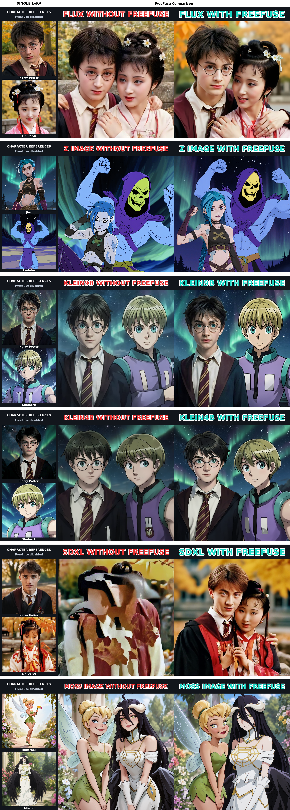

# Character references for the comparison examples

The reference panels show each example LoRA used alone on its corresponding base model, with FreeFuse disabled. These are generated reference images, not original film/anime frames or conditioning inputs.

The existing without/with FreeFuse panels are preserved. Single-character prompts retain the corresponding character description and background from `freefuse_comfyui/tests/test_freefuse_compare.py`; the two-character action is removed. Seeds, steps, guidance, sampler, scheduler and LoRA strengths follow that script. The original five model rows use 1024 × 1024 reference canvases. The appended MOSS row uses the verified 768 × 768 single-LoRA references and 1024 × 1024 native ComfyUI comparison. The chosen MOSS close portrait is recorded in [the candidate manifest](moss_image_square_examples.json). Its exact reference prompts are in [the MOSS reference settings](moss_image_single_references.json). A JSON manifest records exact prompts, settings and weight filenames. These qualitative examples do not establish performance across other prompts, seeds or LoRAs.

The Skeletor reference omits the franchise name and explicitly requests a continuous landscape without captions or logos to avoid a generated poster title card. Its seed, LoRA strength and sampling settings are unchanged.

| Model | Character A | Character B | LoRA strength |
| --- | --- | --- | --- |
| FLUX.1 dev | Harry Potter | Lin Daiyu | 1.0 |
| Z-Image Turbo | Jinx | Skeletor | 0.8 |
| FLUX.2 Klein 9B | Harry Potter | Shalnark | 1.0 |
| FLUX.2 Klein 4B | Harry Potter | Shalnark | 1.0 |
| SDXL base 1.0 | Harry Potter | Lin Daiyu | 1.0 |
| MOSS Image SFT | Tinkerbell | Albedo | 1.0 |



[Exact prompts, settings and verified weight hashes](character_reference_validation.json).

## Reproduce

Install the ComfyUI dependencies and FreeFuse custom nodes first. Download the example LoRAs linked in the project README into ComfyUI `models/loras`. The generator uses explicit model filenames; required files are listed in its `load_base` function. Klein 9B requires access to its official Hugging Face repository.

```bash
python freefuse_comfyui/tests/generate_character_references.py \
  --models flux,z_image,klein9b,klein4b,sdxl \
  --out-dir /absolute/path/to/character_references

python scripts/build_character_reference_comparison.py \
  --original-comparison assets/compare_all.png \
  --reference-dir /absolute/path/to/character_references \
  --moss-comparison-dir /absolute/path/to/moss_square_candidates/close_portrait/moss_image \
  --moss-reference-dir /absolute/path/to/moss_single_references \
  --output assets/compare_all_with_references.png
```

By default, the compositor requires all ten reference images and their manifest. Use `--models flux,z_image,klein4b,sdxl` to build a clearly scoped subset while waiting for licensed Klein 9B weights. It adds a reference column and copies every pixel of the original comparison unchanged. Verify downloaded LoRAs against this repository's Git LFS pointer hashes. The public Hugging Face `shalnark_klein_9b.safetensors` differs from the original pointer; use the original repository LFS object for this example.

The optional MOSS directories contain the verified native `baseline.png` / `freefuse.png` and single-LoRA `tinkerbell.png` / `albedo.png` plus `config.json` with `freefuse: false`. Omit both arguments to rebuild only the original five rows.
