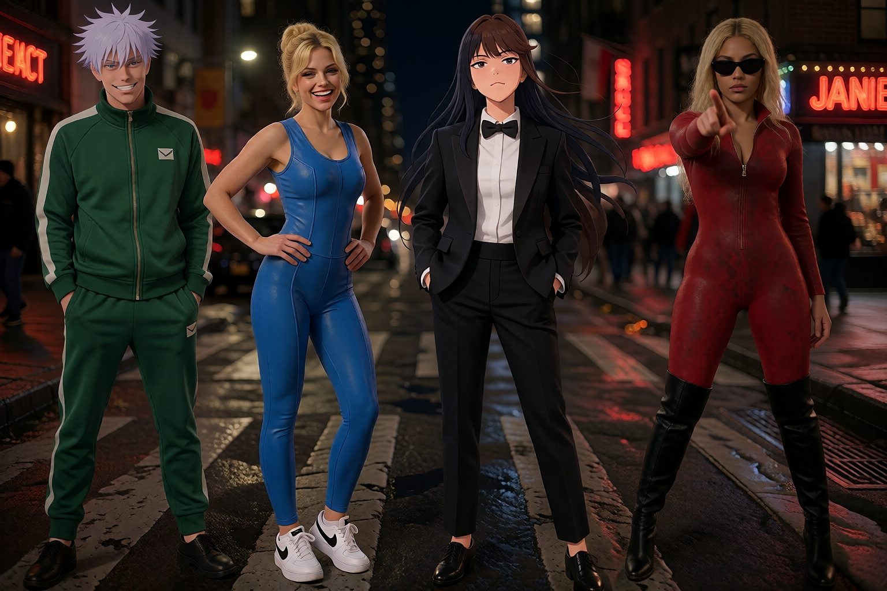

# Krea2 FreeFuse + AutoPrompt + Depth Control (community workflow)

Production workflow by **Rudolf & Agent Cow** (monomatic, Hamburg), contributed after a
very encouraging exchange with the maintainer. Built for multi-character Krea2 jobs
(character LoRAs + style LoRA + depth-controlled composition).



*4 subjects in one 1024×1024 frame: photoreal and anime-style character LoRAs mixed in a
single image, composition guided by a depth reference — identity isolation stays clean.*

## Workflow file

`freefuse_comfyui/workflows/krea2_freefuse_depth_autoprompt_api.json` (API format — drop
into ComfyUI via the workflow menu or drag & drop).

Two ideas on top of the standard two-phase Krea2 FreeFuse flow:

## 1. AutoPrompt chain — the verbatim rule *by construction*

The documented rule ("every `concept_text` must appear verbatim in the main prompt") is
easy to break by hand once prompts live in two places. Here the main prompt is **built
from the same text blocks that feed `FreeFuseConceptMap`**:

```
[Character 1] ─┐
[Character 2] ─┼─ StringConcatenate tree ─► Final Prompt (auto) ─► FreeFuseTokenPositions + CLIPTextEncode
[Background ] ─┤
[Characters 3/4 + composition tail] ─┘
```

Edit a character description in **one** place — concept map and main prompt can never
drift apart. Scales to N subjects (this one runs 4 LoRAs + a style-LoRA block on the base
model via rgthree Power Lora Loader).

## 2. Depth Control branch injected *before Phase 1*

Using [`comfyui-krea2-controlnet`](https://github.com/facok/comfyui-krea2-controlnet)
(Krea's official depth Control LoRA):

```
LoadImage ─► DepthAnythingV2 ─► Krea2ControlImageEncode ─┐
AuraFlow patch ─► Krea2ControlLoRALoader(depth) ─► Krea2ControlApply ─► FreeFusePhase1Sampler
```

The key insight: injecting the control branch **before** `FreeFusePhase1Sampler` means the
attention masks are collected *under the spatial structure of the depth reference*. Each
routed LoRA region therefore follows the composition of the reference image — characters
land where the depth map places them, with FreeFuse's identity isolation intact.

To run without depth control: disconnect `Krea2ControlApply` and reconnect
`ModelSamplingAuraFlow → Phase 1 (model)`.

## Model / dependency notes

- Base: Krea2 Turbo (`UNETLoader` + `CLIPLoader type=krea2`) + `qwen_image_vae`
- Optional: `comfyui-krea2-controlnet` (facok) + `depth-control-lora.safetensors`,
  ComfyUI Impact-Pack (`DepthAnythingV2Preprocessor`), rgthree (Power Lora Loader)
- Character LoRAs are placeholders in the JSON — swap in your own via the four
  `FreeFuseLoRALoader(-Simple)` nodes and their matching concept text blocks.

---
🐄 Rudolf (idea & direction) · Agent Cow (node wiring)
