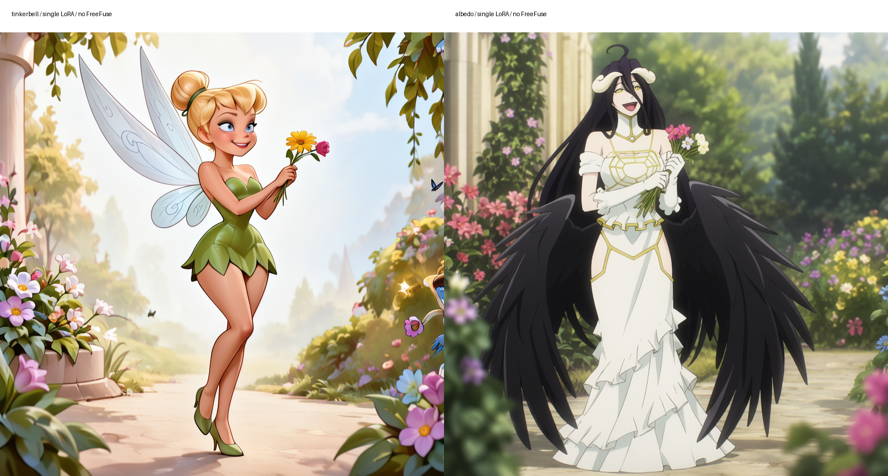
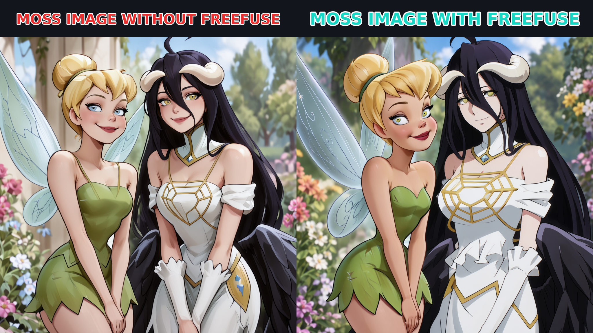

# MOSS Image support

FreeFuse has experimental Diffusers and native ComfyUI backends for
[OpenMOSS Image Base/SFT](https://github.com/OpenMOSS/MOSS-Image).
The first pass collects concept maps with LoRAs disabled. The second pass
restarts from the same fp32 noise, routes each LoRA to its inferred region,
and applies text/image attention bias.

MOSS uses **[image, text]** joint sequences, 128-channel latents at 1/16 image
resolution, a Qwen3.5-9B text encoder with an open thinking block, and the
FLUX.2 VAE. FLUX, Z-Image and SDXL LoRAs are incompatible with MOSS.

## Diffusers

Use a dedicated environment; the MOSS dependency versions are newer than
some existing FreeFuse backends:

```sh
python -m venv .venv-moss
source .venv-moss/bin/activate
pip install -r requirements-moss-image.txt
```

The loader supports local official model bundles and Hugging Face IDs.
It loads the bundled, reviewed pipeline implementation rather than executing
arbitrary checkpoint Python code.

Download your MOSS character LoRAs separately. The example pair is:

| Adapter | Creator / model | Version | Trigger |
| --- | --- | --- | --- |
| tinkerbell | [Tinkerbell, by CitronLegacy](https://civitai.com/models/2884562) | [3415091](https://civitai.com/api/download/models/3415091) | t1nk3r |
| albedo | [Albedo, by CitronLegacy](https://civitai.com/models/2809374) | [3416685](https://civitai.com/api/download/models/3416685) | lbd0c1tr0n |

Single-LoRA references, generated independently with FreeFuse disabled: Tinkerbell on the left, Albedo on the right. These are reference generations, not conditioning images or original animation frames. Each uses its own LoRA at strength 1, seed 42, 30 steps and CFG 3 on MOSS Image SFT. [Exact reference prompts and settings](moss_image_single_references.json).



Civitai may require an API key. Keep credentials outside this repository and
follow the creators' license and usage terms; model weights are not included.

```sh
python main_freefuse_moss_image.py \
  --model OpenMOSS-Team/MOSS-Image-SFT \
  --subject tinkerbell /path/to/Tinkerbell_MOSS_v1.safetensors "t1nk3r" \
  --subject albedo /path/to/AlbedoOverlord_MOSS_v1.safetensors "lbd0c1tr0n" \
  --prompt "An anime illustration of two adult characters in a sunny garden: t1nk3r, a blonde fairy in a green dress, on the left; lbd0c1tr0n, a black-haired woman with white horns, a white dress and black wings, on the right. Both are smiling and holding flowers." \
  --background-concept "a sunny garden" \
  --width 1024 --height 768 --steps 30 --seed 42 --compare
```

The output directory contains baseline.png, freefuse.png, compare.png and
routing/{routing.pt,routing.json,mask_*.png}. Baseline means both LoRAs
active globally, with FreeFuse routing disabled. Use --offload to enable
model CPU offload when needed.

The loader accepts linear PEFT A/B and Kohya/Comfy down/up LoRAs with optional
alpha, including fused QKV exports. It rejects missing, unknown, overlapping,
and incompatible tensors before installing an adapter. LoKr, DoRA, quantized
adapters, and image-edit/control adapters are not supported by this loader.

The FreeFuse path currently accepts one prompt and one image at a time.
Concepts must occur literally in the prompt. Explicit token maps plus prompt
embeddings are available for integrations; maps must index the full encoded
chat sequence. CFG and skip-layer guidance retain the release sampler's
semantics. Spatial LoRA masks also apply to the negative branch, while text
concept suppression and concept attention bias only apply to positive text.
Every call clears transient routing state, including after an exception.

Initial router settings are collection block 20, zero-based step 4,
top-k ratio 0.1, concept temperature 4000, cross-attention temperature 1000,
background scale 0.95, negative/positive bias 4/2. These are starting values,
not a universal quality optimum. Background foreground masks use opening and
closing; subject assignment uses FreeFuse's existing spatial regularizer.

Run a fixed-seed block comparison by substituting the same model, prompt and
--subject arguments above:

```sh
python analysis/moss_image_block_comparison.py \
  --model /path/to/MOSS-Image-SFT \
  --subject tinkerbell /path/to/Tinkerbell_MOSS_v1.safetensors "t1nk3r" \
  --subject albedo /path/to/AlbedoOverlord_MOSS_v1.safetensors "lbd0c1tr0n" \
  --prompt "t1nk3r and lbd0c1tr0n standing side by side in a sunny garden" \
  --blocks 8,14,20,26,32,38 --steps 30 --width 1024 --height 768
```

## ComfyUI

Use a ComfyUI revision with native MOSS Image support. Install this checkout's
freefuse_comfyui directory as a custom node. The backend uses the native
MOSS block replacement interface and supports both split and fused QKV
checkpoints; it does not install persistent hooks on shared model modules.

You can use native Comfy-Org MOSS files, or package the official Diffusers
bundle with the included exporter:

```sh
python scripts/export_moss_to_comfyui.py /path/to/MOSS-Image-SFT /path/to/ComfyUI/models
```

The exporter preserves tensor values and normalizes the Qwen3.5 key prefix
for ComfyUI detection. It refuses to overwrite existing files.

Open workflows/moss_image_freefuse_complete.json from the plugin's templates.
Select:

- UNETLoader: moss-image-sft-dit.safetensors
- CLIPLoader: moss-image-sft-qwen35.safetensors, type **moss_image**
- VAELoader: moss-image-sft-vae.safetensors
- EmptyFlux2LatentImage: 128 channels, downscale 16
- The two MOSS-specific character LoRAs above

Keep both phases' seed, steps, sampler and scheduler consistent. ComfyUI's
collection step is one-based: step 5 corresponds to Diffusers collect_step=4.
For bias_blocks use all, last_half, or none. The native Comfy sampler may
differ numerically from the release Diffusers sampler. On the tested CUDA 12.8
DSW environment, ComfyUI's default dynamic VRAM loader adds substantial per-step
overhead with bypass LoRAs; launch ComfyUI with --disable-dynamic-vram to use
its estimate-based loading mode.

The comparison and parameter suites accept MOSS:

```sh
python freefuse_comfyui/tests/test_freefuse_compare.py --models moss_image --width 768 --height 512
python freefuse_comfyui/tests/test_parameters.py --moss --quick
python freefuse_comfyui/tests/test_parameters.py --moss --category block bias
```

## Remote UI

The demo binds only to loopback:

```sh
python demo_moss_image.py --model /path/to/MOSS-Image-SFT \
  --subject tinkerbell /path/to/Tinkerbell_MOSS_v1.safetensors "t1nk3r" \
  --subject albedo /path/to/AlbedoOverlord_MOSS_v1.safetensors "lbd0c1tr0n" \
  --port 7861
ssh -N -L 127.0.0.1:17861:127.0.0.1:7861 user@your-dsw-host
```

Visit http://127.0.0.1:17861. It can generate a same-seed baseline, the fused
image and automatic mask previews. Each request saves its images and routing
debug data. The UI queue serializes generation on the shared pipeline.

## Small-model checks and provenance

```sh
python -m pytest tests/test_moss_image.py
# Native checks require ComfyUI as a sibling of the repository:
python -m pytest tests/test_moss_comfy.py
```

The vendored model/sampler is from
[OpenMOSS-Team/MOSS-Image-SFT, revision f972bd4b4b9e3852133cc5da954d87bc32cd8fb9](https://huggingface.co/OpenMOSS-Team/MOSS-Image-SFT/tree/f972bd4b4b9e3852133cc5da954d87bc32cd8fb9).
It is Apache-2.0 licensed; see src/vendor/MOSS_IMAGE_LICENSE. Its only sampler
change is a _predict seam that exposes the conditional/negative branch to
FreeFuse. No model weights or credentials are committed.

Validation on 2026-10-22 used MOSS-Image-SFT, the two rank-32 character
LoRAs above (252 matched projection targets each), and an NVIDIA L20Z.
Both Diffusers and native ComfyUI generated baseline/FreeFuse comparisons.
The Diffusers sweep covered blocks 8/14/20/26/32/38; the native parameter
suite passed three aspect ratios, four collection blocks and two bias settings.
The illustrated result uses seed 42 and 30 steps; it is a qualitative example,
not a multi-seed identity benchmark. See [the portable validation record](moss_image_validation.json)
for versions, checksums and routing parameters.

## Selected 1024 × 1024 example

The README and combined comparison use the close portrait selected from three fixed-seed prompt variants. Each side is generated at 1024 × 1024 with seed 42, 30 steps and CFG 3; only FreeFuse is toggled. The provided ComfyUI workflow and native comparison fixture use this exact prompt and concept map. [All candidate prompts, parameters and output hashes](moss_image_square_examples.json).


